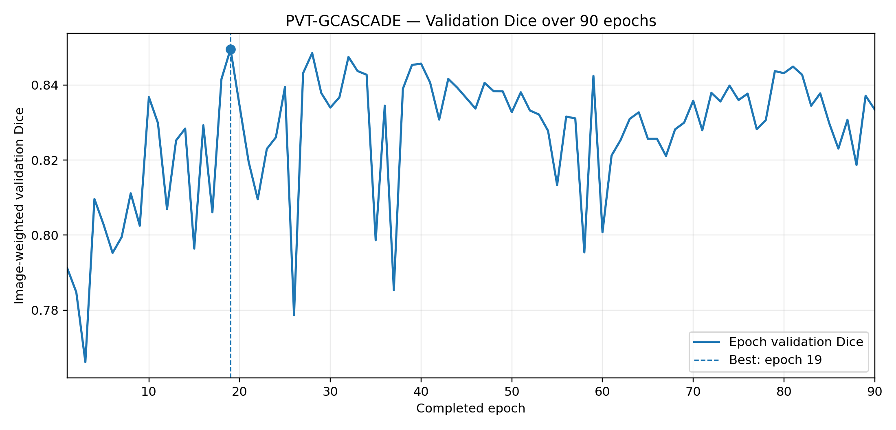
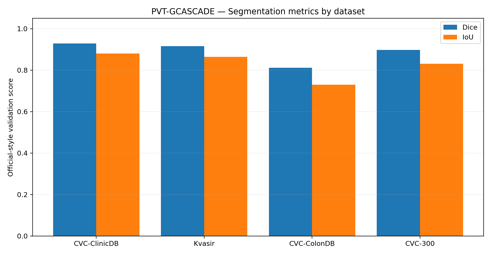

# EN3160 — G-CASCADE: Medical Image Segmentation

**Baseline Reproduction and Robustness Evaluation of G-CASCADE**

EN3160 Computer Vision — Final Project

**Team Members**
- **Abdul** — Baseline reproduction, model training, quantitative evaluation, reproducibility and experiment documentation
- **Mokshan** — Google Colab implementation, robustness extension, image degradation experiments and comparative analysis

## 1. Project Overview

This project reproduces and extends **G-CASCADE: Efficient Cascaded Graph Convolutional Decoding for 2D Medical Image Segmentation**, presented at WACV 2024 by Md Mostafijur Rahman and Radu Marculescu.

G-CASCADE combines a hierarchical transformer encoder with an efficient graph-convolution-based decoder. It aims to preserve long-range contextual information while progressively recovering detailed spatial features for pixel-level medical image segmentation.

Our project focuses on **binary polyp segmentation in colonoscopy images** using PVT-GCASCADE.

We have two primary objectives:

1. **Baseline reproduction:** Reproduce the authors' PVT-GCASCADE implementation and evaluate Dice and mean Intersection over Union (mIoU) on the four official polyp test datasets.
2. **Robustness extension:** Measure segmentation performance under controlled image degradations such as blur, Gaussian noise and illumination changes, and investigate methods for improving robustness.

## 2. Original Research

**Paper:** G-CASCADE: Efficient Cascaded Graph Convolutional Decoding for 2D Medical Image Segmentation

**Authors:** Md Mostafijur Rahman and Radu Marculescu

**Conference:** IEEE/CVF Winter Conference on Applications of Computer Vision (WACV), 2024

- [Original Paper](https://openaccess.thecvf.com/content/WACV2024/html/Rahman_G-CASCADE_Efficient_Cascaded_Graph_Convolutional_Decoding_for_2D_Medical_Image_WACV_2024_paper.html)
- [Official Implementation](https://github.com/SLDGroup/G-CASCADE)
- [Our Shared Repository](https://github.com/mokshan-123/EN3160-CVproject-Gcascade)

**Original upstream commit:** `08d76880027bfe14ed79def1eea3d8a4957fbab6`

**Verified Abdul baseline commit:** `903f095b1abdf25547beb9301e4a1698a02b2310`

**Shared baseline import commit:** `7701e733e7a779466b1dfeabe8fd520f3906ea3a`

The project is based on the official authors' implementation, with documented compatibility modifications and separately developed experimental extensions.

## 3. Model Architecture

Our baseline is **PVT-GCASCADE**, consisting of:

- **PVTv2-B2 encoder:** Extracts hierarchical multi-scale features.
- **Up-Convolution Blocks (UCB):** Efficient feature upsampling using depth-wise convolution.
- **Graph Convolution Blocks (GCB):** Model non-local relationships between spatial features.
- **Spatial Attention (SPA):** Emphasizes relevant regions during decoder refinement.
- **Graph Convolutional Attention Modules (GCAM):** Combine graph convolution with spatial attention.
- **Segmentation Heads:** Generate four decoder-stage prediction maps.

For binary segmentation, the final inference output combines the four prediction maps using additive aggregation followed by sigmoid activation.

The official training procedure applies a structure loss over all 15 non-empty combinations of the four decoder predictions.

## 4. Dataset

We use the authors' released polyp segmentation dataset configuration.

| Dataset | Role | Images |
|---|---|---:|
| TrainDataset | Training | 1,450 |
| CVC-ClinicDB | Evaluation | 62 |
| Kvasir | Evaluation | 100 |
| CVC-ColonDB | Evaluation | 380 |
| CVC-300 | Evaluation | 60 |

The training dataset contains samples from Kvasir and CVC-ClinicDB. The evaluation setup follows the four datasets used by the official implementation.

Expected local directory structure:

```text
data/
└── polyp/
    ├── TrainDataset/
    │   ├── images/
    │   └── masks/
    └── TestDataset/
        ├── CVC-ClinicDB/
        ├── Kvasir/
        ├── CVC-ColonDB/
        └── CVC-300/
```

Each evaluation dataset contains `images/` and `masks/` directories.

**Datasets are not committed to GitHub.** They must be obtained separately and arranged in the expected directory structure.

Dataset package: see the original G-CASCADE repository documentation.

## 5. Development Environment

The verified local development setup is:

| Component | Version |
|---|---|
| Operating system | Windows 11 |
| Python | 3.10.21 |
| PyTorch | 2.2.2+cu121 |
| torchvision | 0.17.2+cu121 |
| NumPy | 1.26.4 |
| SciPy | 1.11.4 |
| GPU | NVIDIA RTX 4050 Laptop GPU, 6 GB |
| Environment | Conda `gcascade` |

The original authors used an older PyTorch environment. Our environment is a compatibility adaptation for modern hardware; it should not be interpreted as an identical software reproduction.

Use the documented, compatible local environment. The upstream `requirements.txt` is retained for reference and should not be assumed to install successfully unchanged on every modern Windows/CUDA system.

## 6. Baseline Training Configuration

The intended official baseline uses:

| Parameter | Configuration |
|---|---|
| Model | PVT-GCASCADE |
| Encoder | PVTv2-B2 |
| Skip aggregation | Additive |
| Image resolution | 352 × 352 |
| Batch size | 4 |
| Optimizer | AdamW |
| Learning rate | 0.0001 |
| Weight decay | 0.0001 |
| Multi-scale factors | 0.75, 1.0, 1.25 |
| Gradient clipping | 0.5 |
| Structure loss | Weighted BCE + weighted IoU |
| Loss aggregation | 15 combinations of 4 decoder outputs |
| Nominal epochs | 200 |

**Implementation detail:** The upstream training loop uses `range(1, opt.epoch)`, resulting in 199 loop iterations for `--epoch 200`.

Any changes introduced for memory efficiency, resumability or compatibility must be documented in the experiment logs.

### Example baseline training command

From the repository root, with the dataset and pretrained encoder weights correctly configured:

```powershell
conda activate gcascade
python train_polyp.py --encoder PVT --skip_aggregation additive --train_path ./data/polyp/TrainDataset/ --test_path ./data/polyp/TestDataset/ --train_save ./model_pth/PVT-GCASCADE/
```

Before full training, we must verify that the complete official training loop runs successfully with the 15-combination loss, all three scales and validation.

**Do not treat prior partial smoke tests as successful full-protocol training.**

## 7. Baseline Evaluation

The official evaluation script is `test_polyp.py`.

Example:

```powershell
python test_polyp.py --encoder PVT --skip_aggregation additive --testsize 352 --pth_path "./model_pth/PVT-GCASCADE/<checkpoint>.pth"
```

Replace `<checkpoint>.pth` with the actual saved checkpoint filename.

The two primary evaluation metrics are:

**Dice Similarity Coefficient**

```text
Dice = 2TP / (2TP + FP + FN)
```

**Intersection over Union**

```text
IoU = TP / (TP + FP + FN)
```

The official evaluation preprocessing, output aggregation, thresholding, per-image metric computation and averaging procedures must be followed consistently when comparing with the paper.

### Paper Reference Results

The following targets are reported for PVT-GCASCADE in the authors' supplementary results:

| Evaluation dataset | Paper Dice (%) | Paper mIoU (%) |
|---|---:|---:|
| CVC-ClinicDB | 94.68 | 90.18 |
| Kvasir | 92.74 | 87.90 |
| CVC-ColonDB | 82.61 | 74.60 |
| EndoScene / 60-image external set | 90.56 | 83.87 |

The official repository uses the `CVC-300` folder name for the 60-image external evaluation set.

These paper values are averages over five runs and are **reference targets, not results achieved by our project**.

### Scientific Evaluation Limitation

The official code selects its best checkpoint using an aggregate Dice score across the four evaluation datasets.

Consequently, those same datasets are used in model selection and final reporting. This limits claims that they represent completely independent holdout testing.

We preserve this behavior for baseline fidelity and will explicitly distinguish any alternative evaluation protocol.

## 8. Robustness Extension

Our research extension investigates performance degradation under realistic endoscopic imaging conditions.

Planned image degradations include:

- Gaussian noise
- Motion or defocus blur
- Low illumination
- Reduced contrast
- JPEG compression artifacts

The experiments will compare clean-image and corrupted-image performance while preserving the original ground-truth masks.

Possible recovery methods include classical image preprocessing and targeted training augmentation.

The extension will use consistent data, metric implementations and checkpoint-selection rules to ensure fair comparisons with the baseline.

**Extension experiments are planned and must not be reported as completed until evaluated.**

## 9. Repository Organization

Important repository components include:

```text
EN3160-CVproject-Gcascade/
├── README.md
├── train_polyp.py
├── test_polyp.py
├── requirements.txt
├── lib/
│   ├── networks.py
│   ├── decoders.py
│   └── gcn_lib/
├── utils/
├── docs/
│   ├── abu_baseline_README.md
│   ├── experiment_log.md
│   └── upstream_version.txt
├── scripts/
├── experiments/
└── results/
```

Some directories are placeholders for future experiments or outputs.

Local-only, ignored resources include:

```text
data/
pretrained_pth/
model_pth/
checkpoints/
result_map/
```

## 10. Collaboration Workflow

We use Git branches to separate stable code from ongoing experiments.

| Branch | Purpose |
|---|---|
| `main` | Reviewed shared project source |
| `Abu` | Abdul's baseline training and evaluation development |
| `Mok` | Mokshan's Colab workflow and robustness extension |
| `baseline-import` | Original verified baseline import history |

Changes should be reviewed before integration into `main`.

The original source, compatibility fixes and experimental extensions should remain clearly distinguishable.

Dataset files, pretrained model weights, trained checkpoints and private storage credentials must not be committed.

## 11. Verification and Progress

### Completed

- Five-minute paper presentation
- Dataset counts and image/mask pairing checks
- CUDA compatibility test on the RTX 4050
- Pretrained PVTv2-B2 checkpoint loading
- PVT-GCASCADE model construction
- Real-image forward propagation
- Structure-loss import
- Backpropagation and AdamW update
- Batch-size-1 and batch-size-4 partial training smoke tests
- Minimal NumPy compatibility fix
- Verified baseline import into the shared repository

### In Progress / Pending

- Full official 15-combination, multi-scale training-loop verification
- Reliable optimizer-state checkpoint resumption
- Complete baseline training
- Quantitative evaluation on all four test datasets
- Predicted mask visualization and qualitative analysis
- Controlled robustness experiments
- Final demonstration integration

The earlier batch-size-4 memory test did not include the full official combinatorial loss and therefore does not establish that the complete training loop fits into 6 GB VRAM.

## 12. Experiment Reproducibility

Each experiment should record:

- Git commit hash and branch
- Random seed
- Dataset and preprocessing
- Model architecture and encoder initialization
- Hyperparameters and epoch count
- Training loss configuration
- Software and GPU environment
- Peak GPU memory and runtime
- Checkpoint filename and selection criterion
- Evaluation protocol and per-dataset Dice/mIoU
- Deviations from the authors' implementation

The baseline and extension should be evaluated under matching settings wherever possible.

## Verified research reproduction and demonstration

Our coursework reproduces **PVT-GCASCADE** for binary polyp segmentation, based on the [original G-CASCADE implementation](https://github.com/SLDGroup/G-CASCADE). The architecture is the original authors' work. We added compatibility fixes, resumable training, evaluation and visualization utilities, automated checks, and a local Streamlit dashboard. Our teammate's robustness investigation is a separate proposed extension; results should only be added once verified.

### Research question and scope

Can the official PVT-GCASCADE polyp segmentation pipeline be reproduced on a laptop GPU, and how accurately does the saved checkpoint segment images on the four validation datasets? We reproduce the original architecture rather than propose a new decoder.

### Experimental protocol

| Item | Reproduced setting |
|---|---|
| Encoder / decoder | PVTv2-B2 / G-CASCADE, additive skip aggregation |
| Training inputs | 352 × 352, batch size 4, three-scale training |
| Objective | Combined weighted BCE + weighted IoU; all 15 non-empty decoder-output combinations |
| Optimizer | AdamW, learning rate 0.0001, weight decay 0.0001 |
| Run status | 90 of 199 planned epochs, 18 five-epoch sessions |
| Model selection | Image-count-weighted validation Dice, best epoch 19 |
| Hardware | NVIDIA RTX 4050 Laptop GPU (6 GB) |

Training was stopped early for the coursework deadline. Later epochs did not exceed the epoch-19 best score. A saved **best model** and **resume checkpoint** serve different purposes and are not interchangeable.

### Recorded validation results

| Dataset | Images | Official-style Dice | Official-style IoU |
|---|---:|---:|---:|
| CVC-ClinicDB | 62 | 0.928477 | 0.880758 |
| Kvasir | 100 | 0.916251 | 0.864641 |
| CVC-ColonDB | 380 | 0.811656 | 0.729943 |
| CVC-300 | 60 | 0.897185 | 0.831153 |
| **Image-weighted overall** | **602** | **0.849587** | **0.777938** |

**Important limitation:** These datasets were also used for model selection, so these are validation results, **not independently held-out test results**. Original paper results and single-run reproduced results should be compared with matching preprocessing and metric definitions, and paper-reported multi-run variability should not be interpreted as uncertainty for our single run.

### Figures generated from saved records





Regenerate without model loading or retraining:

```powershell
conda activate gcascade
python -m pip install matplotlib
python scripts/plot_results.py
```

The script checks the 90-epoch CSV, weighted Dice calculations, dataset counts and best epoch, then saves a JSON manifest containing hashes of the source CSV files and generated figures.

### Live dashboard (local assets required)

```powershell
conda activate gcascade
python -m pip install streamlit
python -m streamlit run scripts/web_demo_polyp.py
```

Use the sidebar to locate the saved `*-best.pth` checkpoint and `data/polyp/TestDataset`, then choose a dataset and image or upload an image and optional mask. The app shows a binary predicted mask, overlay and ground truth, and computes Dice/IoU **only** when a corresponding mask is available. A verified CVC-ClinicDB example is `171.png` (Dice approximately 0.9757). Weights, datasets and generated prediction masks are not in Git.

### Code and artifact navigation

| Purpose | Location |
|---|---|
| Neural network architecture | `lib/networks.py`, `lib/decoders.py`, `lib/gcn_lib/` |
| Training and checkpoint continuation | `train_polyp.py`, `utils/training_checkpoint.py`, `scripts/run_polyp_session.ps1` |
| Official-style evaluation | `scripts/evaluate_polyp.py`, `utils/polyp_evaluation.py` |
| Interactive browser demonstration | `scripts/web_demo_polyp.py` |
| Training metrics by epoch | `results/baseline/session_metrics.csv` |
| Best model metadata | `results/baseline/best_model.json` |
| Per-dataset validation metrics | `results/baseline/final_evaluation_summary.csv` |
| Reproduction status and caveats | `docs/training_progress.md`, `docs/final_demo.md` |
| Plot generator and source-hash manifest | `scripts/plot_results.py`, `docs/images/figure_manifest.json` |

### Attribution and contribution boundaries

The architecture and original research belong to Rahman and Marculescu (WACV 2024). Our coursework contributions are deployment/compatibility work, full-state resumability, evaluation/reporting, reproducibility checks and an interactive demonstration. **No architectural novelty is claimed.** Robustness tests are a possible research extension and should be documented in their own experiment folder with clean/degraded comparisons, settings, saved metrics and limitations after execution.

## 14. Acknowledgments and Citation

This project builds upon the official G-CASCADE research and implementation by Md Mostafijur Rahman and Radu Marculescu.

```bibtex
@inproceedings{rahman2024gcascade,
  title={G-CASCADE: Efficient Cascaded Graph Convolutional Decoding for 2D Medical Image Segmentation},
  author={Rahman, Md Mostafijur and Marculescu, Radu},
  booktitle={Proceedings of the IEEE/CVF Winter Conference on Applications of Computer Vision},
  year={2024}
}
```

The original authors retain credit for their research and implementation. Our coursework contributions focus on reproducibility, local execution, empirical evaluation and robustness analysis.

---

**EN3160 Computer Vision Final Project — Abdul & Mokshan**
